# drive-aware-e2e-driving

Uncertainty-Aware End-to-End Autonomous Driving with Self-Introspection and Risk-Adaptive Planning.

A compact camera-based driving policy (a CNN, and a CNN + GRU variant) predicts future ego
waypoints. An introspection head predicts the probability of a driving failure within the next
2 s from the policy's own internal state. Trajectory uncertainty is estimated separately
(ensembles, MC dropout), and a risk-adaptive planner will act on these signals (Phase 8). The study asks whether calibrated introspection
improves closed-loop safety, and under which conditions. Hypotheses, baselines and the
evaluation protocol were fixed before any results: see
[docs/research_plan.md](docs/research_plan.md) and
[docs/experiment_protocol.md](docs/experiment_protocol.md).

<table>
<tr>
<td>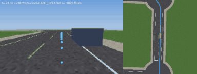</td>
<td>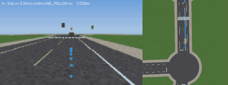</td>
</tr>
<tr>
<td><sub><b>Model A</b> (single-frame CNN), first <code>test_id</code> scenario, last 24 s in
real time: rear-end collision at 87% route completion.</sub></td>
<td><sub><b>Model B</b> (frozen CNN + GRU over 4 frames), <i>same</i> scenario: leaves the road
at 49% route completion.</sub></td>
</tr>
</table>
<sub>Each clip: left, the 160×96 policy camera with predicted waypoints (dots); right, the
privileged top-down view (planned route in blue). One scenario, not cherry-picked. Aggregate
results are below.</sub>

## Status

| Phase | Content | State |
|---|---|---|
| 0 | Research design, architecture, environment assessment | done |
| 1 | Repository, environment, core contracts, smoke training | done |
| 2 | Lightweight closed-loop simulator, controller, replay/video | done |
| 3 | Rule-based expert, expert dataset (128k frames), labels, validation | done |
| 4 | Model A: single-frame CNN behaviour cloning, open- and closed-loop evaluation | done |
| 5 | Model B: temporal (GRU) policy with controls and ablations | done |
| 6 | Failure prediction (introspection) with heuristic and privileged baselines | done |
| 7 | Trajectory uncertainty: MC dropout, Laplace head, deep ensemble | done |
| v2 | Pre-registered benchmark redesign (realistic junctions and signals); Phases 3–7 re-run | done |
| 8–12 | Risk adaptation, robustness, CARLA, report | not started |

## Simulator and data

A purpose-built 2D simulator (numpy + OpenCV, CPU-only). It has procedural towns, signalised
junctions, IDM traffic, pedestrians, parked cars, a pseudo-perspective front camera, and
deterministic snapshots for counterfactual replays.

<table>
<tr>
<td width="38%">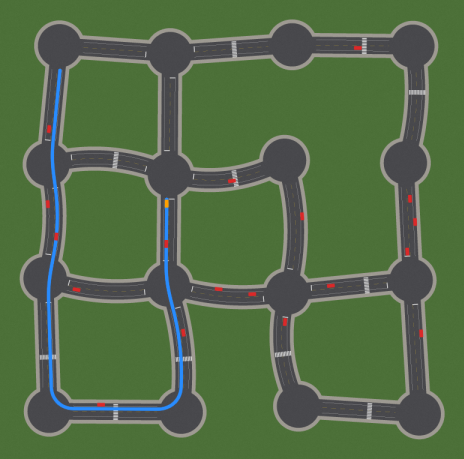</td>
<td>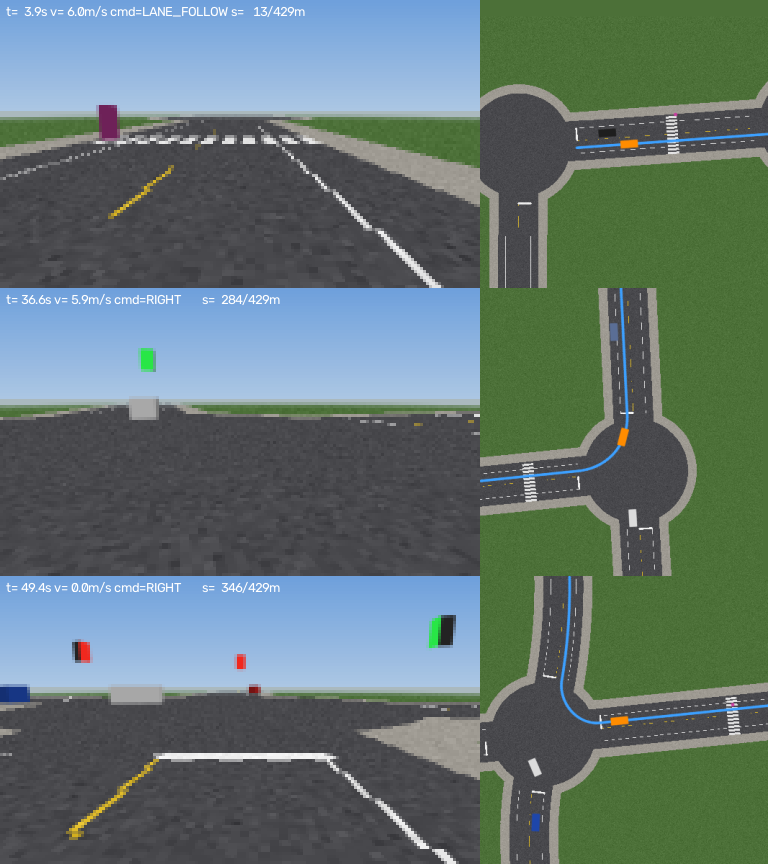</td>
</tr>
<tr>
<td><sub>A procedural town (map seed 205, not used for training or testing). Planned route in
blue, vehicles in red, ego in orange.</sub></td>
<td><sub>The rule-based expert cruising, turning right, and waiting at a red light. Left: what
the policy sees (160×96, upscaled). Right: the top-down debug view.</sub></td>
</tr>
</table>

<p align="center">
  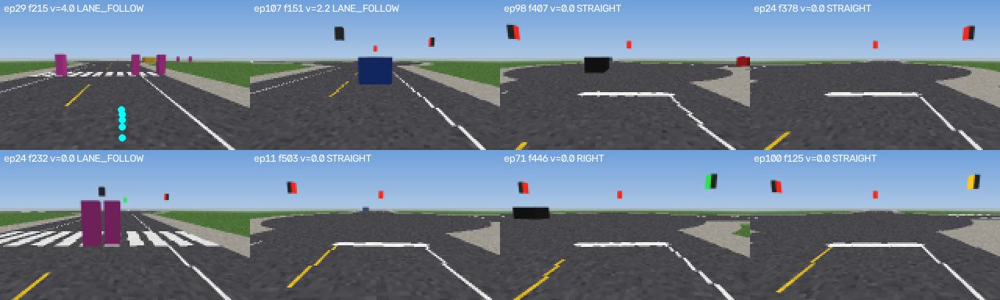
  <br>
  <sub>Training samples with their labels: the expert's future rear-axle positions over 2 s,
  projected into the camera image. Stopped frames show no dots, because all labels sit at the
  rear axle, behind the camera.</sub>
</p>

## Results

All numbers are on held-out `test_id` maps. All agents drive the same scenarios, and learned
models are reported as the mean ± sd over 3 training seeds. Full tables, paired statistics and
diagnoses are in [docs/results.md](docs/results.md).

### Benchmark v2: does a more realistic world fix the policy? No, but the findings replicate.

The v1 policies failed mostly inside featureless junction discs, and signal heads were a few
pixels wide. Before Phase 8, a **pre-registered** redesign
([docs/benchmark_v2.md](docs/benchmark_v2.md)) changed only what the camera sees:
- chamfered kerbs;
- guide lines through junctions;
- larger signal heads plus near-side heads.

Expert trajectories and labels are identical; the whole Phase 3–7 pipeline was re-run with
the same seeds.

<p align="center">
  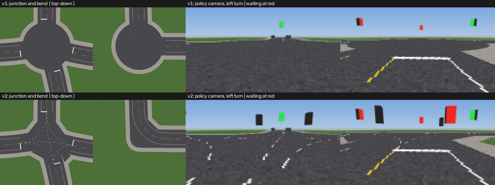
</p>

<p align="center">
  <picture>
    <source media="(prefers-color-scheme: dark)" srcset="docs/assets/benchmark_v1_v2_results_dark.png">
    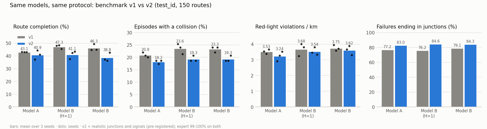
  </picture>
</p>

| | v1 | v2 |
|---|---|---|
| Expert route completion | 99.99% | 99.99% |
| Policy route completion (A / B(H=1) / B) | 0.43 / 0.47 / 0.46 | 0.41 / 0.41 / 0.39 |
| Temporal effect, B − B(H=1) | −0.010 [−0.026, 0.006] | −0.024 [−0.042, −0.006] |
| **Introspection AUROC / PR-AUC** | **0.971 / 0.796** | **0.973 / 0.815** |
| Introspection − best heuristic (ΔAUROC) | +0.12 to +0.17 | +0.13 to +0.17 |
| Uncertainty adds to introspection | ±0.004 | ≤ +0.003 |

- **The redesign did not make behaviour cloning competent.** The policies still drift inside
  junctions. The realistic kerbs now end the drift earlier: off-road rather than route
  deviation, mostly on right turns. Completion even drops slightly. This is reported as the
  pre-registered negative result it is.
- **The research findings replicate on a world with different failure modes.** Introspection
  predicts failures as well as on v1, including the anticipation stratum (PR-AUC 0.58).
  Temporal context still does not help, and uncertainty still under-reacts to image shift and
  adds nothing to failure prediction.

### Phase 7: is trajectory uncertainty the same as failure risk? No.

Three ways to attach uncertainty to model B's predicted trajectory:
- **MC dropout.**
- **A Laplace head** that predicts its own error scale (aleatoric).
- **A 5-member ensemble of GRU heads** whose disagreement measures model uncertainty
  (epistemic). The members share the frozen encoder.

<p align="center">
  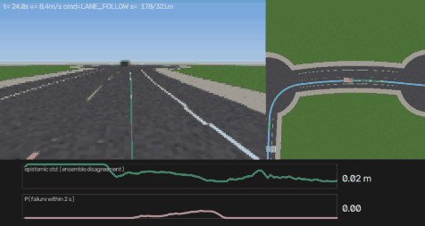
  <br>
  <sub>The collision episode from Phase 6, now with the 5 ensemble trajectories (teal) and 2σ
  ellipses (yellow). <b>Epistemic std</b> (top timeline, scaled to its own range; about 0.02–0.04 m)
  stays flat while <b>P(failure)</b> (bottom) rises to 0.94. The policy is confidently
  wrong, which introspection catches and trajectory uncertainty does not.</sub>
</p>

| Clean test_id (3 seeds) | ADE | ρ(σ, error) | AUROC for high error | 1σ coverage, raw → calibrated | Predicts failure (AUROC) |
|---|---|---|---|---|---|
| MC dropout | 0.167 | 0.46 | 0.61 | 0.55 → 0.66 | 0.63 |
| Laplace head | 0.162 | 0.57 | 0.70 | 0.85 → 0.67 | 0.52 |
| Ensemble (5 heads) | **0.160** | 0.57 | 0.69 | 0.33 → 0.68 | 0.66 |
| Introspection (Phase 6), for comparison | — | — | — | — | **0.971** |

<table>
<tr>
<td width="50%">
  <picture>
    <source media="(prefers-color-scheme: dark)" srcset="docs/assets/uncertainty_corruptions_dark.png">
    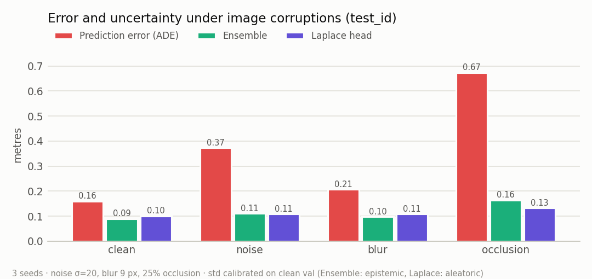
  </picture>
</td>
<td>
  <picture>
    <source media="(prefers-color-scheme: dark)" srcset="docs/assets/uncertainty_failure_link_dark.png">
    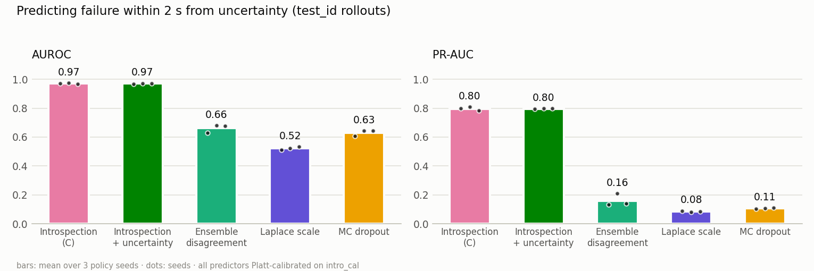
  </picture>
</td>
</tr>
</table>

- **Uncertainty ranks errors moderately well, but its raw scale is wrong.** The ensemble is
  4× over-confident and the Laplace head 2× too wide. One scale fitted on val fixes 1σ coverage,
  but 2σ coverage stays at 0.82 instead of 0.95 because errors are heavy-tailed.
- **It under-reacts to unfamiliar input.** Image noise, blur and occlusion raise the error up
  to 4.2×, but calibrated uncertainty only 1.0–1.8×, so 1σ coverage falls to 0.30 under
  occlusion. A shared frozen encoder is the likely reason.
- **It is not failure risk.** Alone it predicts failures poorly (best AUROC 0.74 for all
  signals combined), and added to the introspection head it changes nothing (ΔAUROC within
  ±0.004). Introspection captures what the policy is about to do; trajectory uncertainty
  captures how precisely that can be predicted.

<details>
<summary>Uncertainty vs error and sparsification curves</summary>

<table>
<tr>
<td width="50%">
  <picture>
    <source media="(prefers-color-scheme: dark)" srcset="docs/assets/uncertainty_vs_error_dark.png">
    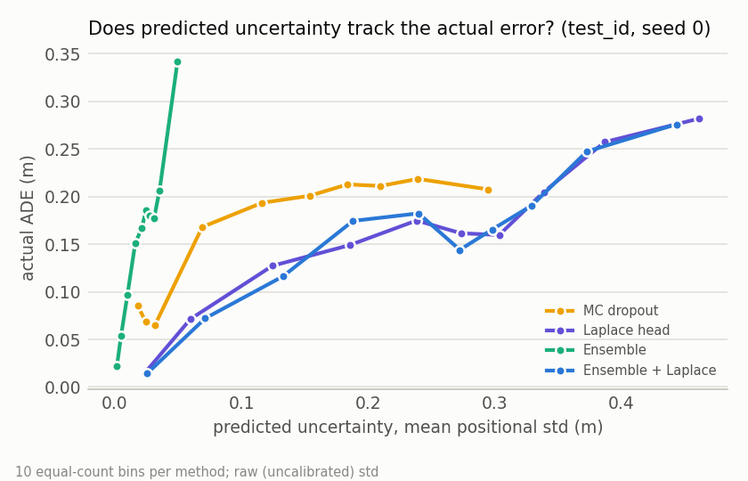
  </picture>
</td>
<td>
  <picture>
    <source media="(prefers-color-scheme: dark)" srcset="docs/assets/uncertainty_sparsification_dark.png">
    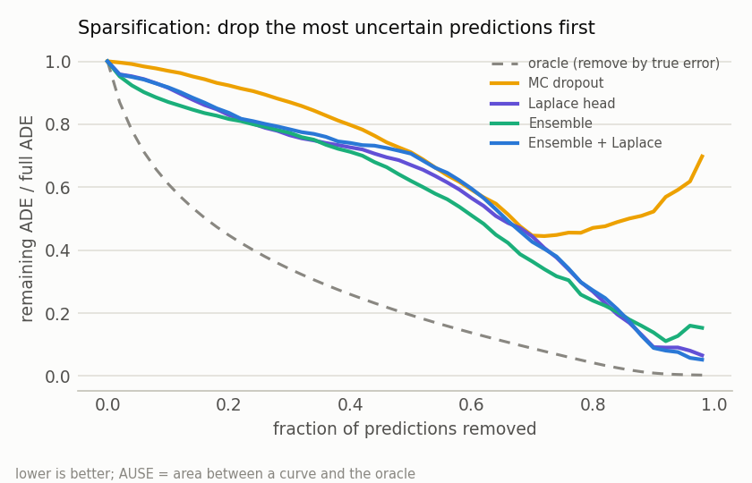
  </picture>
</td>
</tr>
</table>
</details>

### Phase 6: can the driving model predict its own failures? Yes, with caveats.

A 45k-parameter head reads the frozen policy's GRU state, speed, command and predicted waypoints.
It outputs a calibrated probability that a collision, off-road, route deviation, red-light
violation or stall happens within the next 2 s. It is trained on the policy's own closed-loop
rollouts on separate maps.

<table>
<tr>
<td>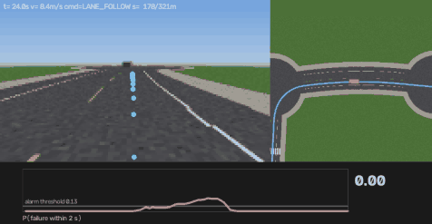</td>
<td>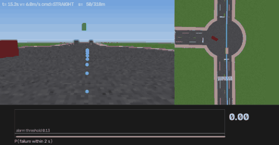</td>
</tr>
<tr>
<td><sub>First <code>test_id</code> episode ending in a <b>collision</b> (model B, seed 0): the
probability (pink) crosses the alarm threshold and WARNING is shown about 1.4 s before the
rear-end impact.</sub></td>
<td><sub>First test episode ending <b>off-road</b>: the car cuts the inside of a bend, and the
warning appears about 1 s before it leaves the road. The red vertical line marks the failure
event.</sub></td>
</tr>
</table>

| Predicting failure within 2 s (test_id, 3 policy seeds) | AUROC | PR-AUC | ECE | Events warned in time | False alarms / km |
|---|---|---|---|---|---|
| **Introspection (C)** | **0.971 ± 0.003** | **0.796 ± 0.012** | **0.011** | **98.7%** | 19.2 |
| All non-privileged heuristics combined | 0.828 ± 0.021 | 0.307 ± 0.018 | 0.020 | 70.3% | 19.2 |
| "Near a junction" heuristic (speed + command) | 0.780 ± 0.013 | 0.194 ± 0.020 | 0.036 | 36.8% | 4.6 |
| Privileged reference (TTC, lateral offset, junction) | 0.865 ± 0.015 | 0.364 ± 0.011 | 0.035 | 59.7% | 9.0 |

<p align="center">
  <picture>
    <source media="(prefers-color-scheme: dark)" srcset="docs/assets/introspection_metrics_dark.png">
    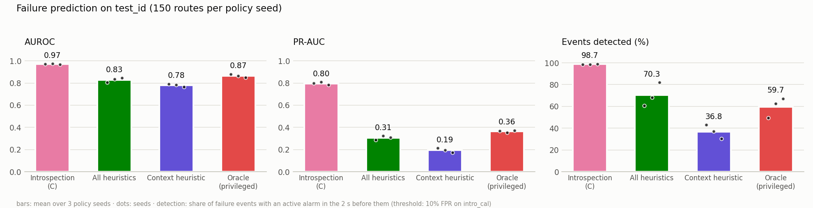
  </picture>
</p>

<p align="center">
  <picture>
    <source media="(prefers-color-scheme: dark)" srcset="docs/assets/introspection_roc_pr_dark.png">
    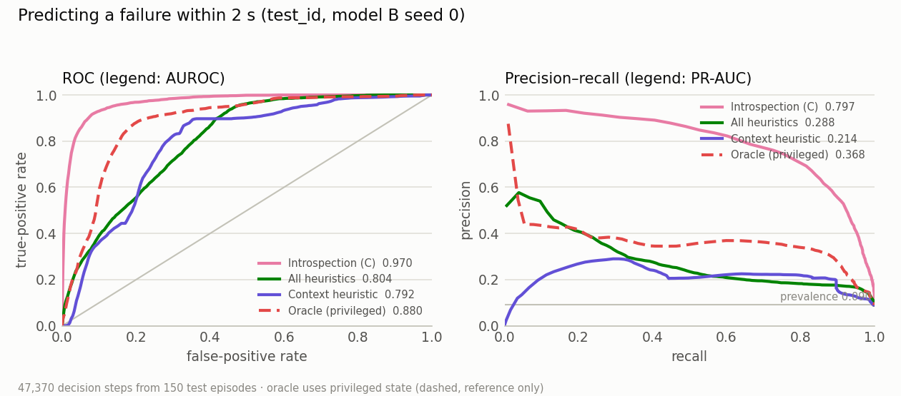
  </picture>
</p>

- **It anticipates, it does not just notice.** Restricted to moments 1–2 s before a failure,
  while the car is still within 1 m of its lane centre, introspection keeps AUROC 0.972 and
  PR-AUC 0.57. The heuristics drop to PR-AUC 0.07. Some failure labels (route deviation,
  off-road) are only registered once things look bad, so this check matters.
- **It beats the best heuristic for every seed (H2).** ΔAUROC is +0.12 to +0.17 and ΔPR-AUC +0.47
  to +0.51, all with episode-bootstrap CIs well above zero.
- **Calibrated probabilities need a held-out step.** Raw head outputs have ECE 0.04–0.08;
  Platt scaling on a separate calibration split brings test ECE to 0.006–0.014.
- **Caveats.** Model B fails often and systematically (135 of 150 test episodes contain a
  failure), which makes its failures predictable. Expect lower numbers for a more competent
  policy, and under distribution shift (Phase 9). At this operating point there are about 19
  alarm onsets per km. Whether acting on them helps is Phase 8's question.

<table>
<tr>
<td width="50%">
  <picture>
    <source media="(prefers-color-scheme: dark)" srcset="docs/assets/introspection_reliability_dark.png">
    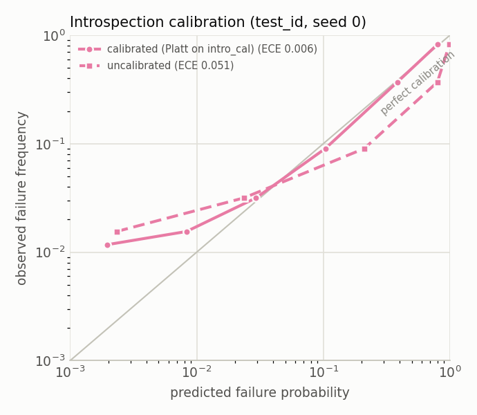
  </picture>
</td>
<td>
  <picture>
    <source media="(prefers-color-scheme: dark)" srcset="docs/assets/introspection_lead_time_dark.png">
    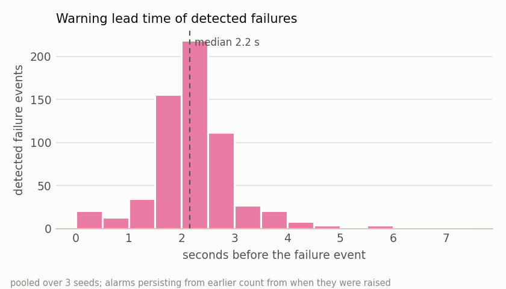
  </picture>
</td>
</tr>
</table>

### Phase 5: does temporal context help? Not in this setup.

Model B feeds the frozen model-A encoder's features for the last 4 frames through a GRU. A
**control, B (H=1)**, has the same frozen features and head training but no history. It
separates "temporal context" from "retraining the head".

| 150 paired routes | Route completion | Routes completed | Episodes with a collision | Red-light violations / km |
|---|---|---|---|---|
| Expert | 1.000 | 99.3% | 0% | 0 |
| Model A (single frame) | 0.431 ± 0.002 | 11.3 ± 1.8% | 20.9 ± 1.0% | 3.53 ± 0.15 |
| Model B (H=1) control | 0.473 ± 0.016 | 15.1 ± 1.0% | 23.6 ± 2.0% | 3.68 ± 0.40 |
| **Model B (H=4)** | **0.463 ± 0.026** | **13.8 ± 2.5%** | **23.3 ± 1.2%** | **3.75 ± 0.18** |

<p align="center">
  <picture>
    <source media="(prefers-color-scheme: dark)" srcset="docs/assets/closed_loop_phase5_dark.png">
    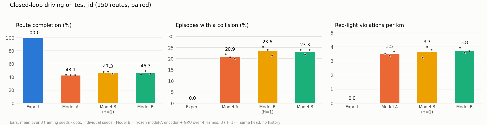
  </picture>
</p>

- **History adds nothing measurable.** Paired B(H=4) − B(H=1): route completion −0.010
  [95% CI −0.026, 0.006]. Collisions and red-light violations are also unchanged. This is
  a negative result for hypothesis H1.
- **The gain over model A is a training-recipe effect.** B(H=1) − A is +0.042 [0.023, 0.061]
  route completion, the same gain B(H=4) shows. Without the control, it would have looked
  like evidence for H1.
- **Starting from rest improves slightly**, the case where one frame lacks timing cues:
  0.287 → 0.266 → 0.254 m ADE (A → B(H=1) → B). The change is within seed variation.
  History lengths from 1 to 8 frames change val ADE by under 0.003 m.

<table>
<tr>
<td width="56%">
  <picture>
    <source media="(prefers-color-scheme: dark)" srcset="docs/assets/situations_phase5_dark.png">
    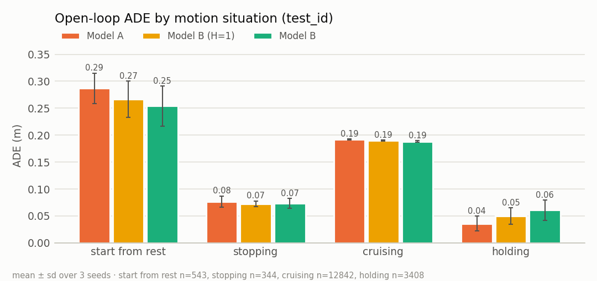
  </picture>
</td>
<td>
  <picture>
    <source media="(prefers-color-scheme: dark)" srcset="docs/assets/history_ablation_dark.png">
    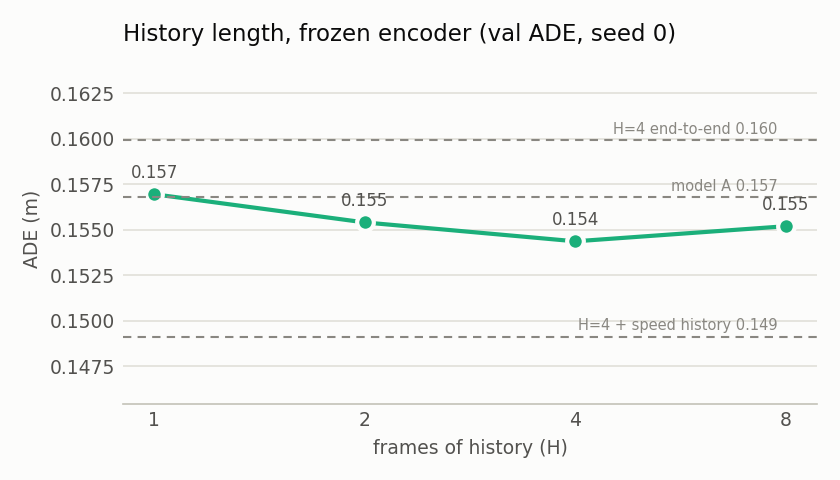
  </picture>
</td>
</tr>
</table>

Feeding past speeds lowers open-loop error (0.149 m), but almost entirely on cruising frames.
That is consistent with the inertia ("copycat") shortcut, so it is kept as an ablation, not
adopted. Fine-tuning the encoder end to end (one seed, 55 min instead of about 1 min) does not help
either: route completion is 0.436 vs 0.447 for frozen B on the same seed. The result covers
temporal aggregation over ≤ 0.7 s of history.

### Phase 4: single-frame behaviour cloning

Model A predicts waypoints well on logged data: test ADE is 0.162 ± 0.002 m, against 0.768 m for
constant-velocity extrapolation. But it drives poorly: on the original 50-route set it completes
0.413 ± 0.011 of the route distance and finishes 8.7% of routes.
- **The pipeline is sound.** An oracle feeding privileged route waypoints through the same
  controller completes every route.
- **Junctions.** 76% of failures happen inside junctions. These are large, unmarked asphalt
  areas where the camera has little to anchor on.
- **Signals.** Signal heads are only a few pixels wide.

<p align="center">
  <picture>
    <source media="(prefers-color-scheme: dark)" srcset="docs/assets/training_curves_model_a_dark.png">
    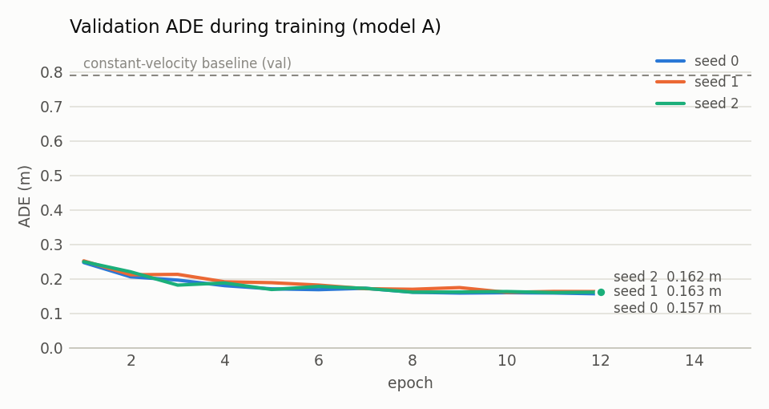
  </picture>
</p>

### Open decisions

1. ~~**Junction appearance (simulator v2)**~~: done and pre-registered. It did not improve
   driving (see above); both benchmarks stay reported.
2. **DAgger** with the expert as the labeller. This is the pre-registered fallback and targets
   the compounding error that v2 did not fix.
3. **Route target-point conditioning** in addition to discrete commands (TransFuser-style).

## Installation (Ubuntu 22.04 / WSL2, Python 3.10)

```bash
python3.10 -m venv .venv
source scripts/env.sh                       # activates .venv and isolates it from ROS 2 (see below)
pip install --upgrade pip
pip install torch==2.14.1 torchvision --index-url https://download.pytorch.org/whl/cu126
pip install -e ".[dev]"
python -c "import torch; print(torch.cuda.is_available(), torch.cuda.get_arch_list())"
```

CPU-only machines: install `torch` from `https://download.pytorch.org/whl/cpu` instead.
The full CUDA environment is about 6.7 GB on disk. Development hardware: GTX 1650 Ti (4 GB),
Ryzen 7 4800H, 7.4 GiB RAM under WSL2 (see [docs/environment.md](docs/environment.md)).

**Always activate with `source scripts/env.sh`.** If ROS 2 is sourced in `~/.bashrc`, its
`PYTHONPATH` takes precedence over the venv and makes pytest load ROS plugins, which fails at
import. `env.sh` clears it for the current shell only.

## Reproducing

```bash
source scripts/env.sh
pytest                                                    # CPU unit tests
ruff check . && ruff format --check . && mypy

python scripts/collect_dataset.py --config configs/data/expert_v1.yaml   # ~9 min, 6.7 GB
python scripts/inspect_dataset.py data/expert_v1/train                  # stats + label montage
python scripts/eval_expert.py                                           # expert reference

for s in 0 1 2; do                                        # model A: ~13 min per seed
  python scripts/train_bc.py --config configs/training/model_a.yaml --set seed=$s
done
for s in 0 1 2; do                                        # model B and its H=1 control: ~2 min
  A=$(ls -d experiments/*_model_a_seed$s)/best.pt
  python scripts/train_bc.py --config configs/training/model_b.yaml --set seed=$s encoder_checkpoint=$A
  python scripts/train_bc.py --config configs/training/model_b.yaml --set seed=$s encoder_checkpoint=$A name=model_b_h1 history=1
done
python scripts/eval_closed_loop.py --set-name test_id --expert --workers 6 \
    --checkpoints experiments/*_model_a_seed*/best.pt experiments/*_model_b_h*_seed*/best.pt
python scripts/summarize_phase5.py --report experiments/<ts>_closed_loop_test_id/report.json
python scripts/run_introspection.py --seeds 0 1 2         # rollouts + introspection, ~75 min
python scripts/analyze_introspection.py --run-dir experiments/<ts>_introspection
for k in 0 1 2; do for m in 0 1 2 3 4; do                 # 15 probabilistic heads, ~1 min each
  python scripts/train_bc.py --config configs/training/model_b_prob.yaml --set seed=$((10*k+m)) \
    encoder_checkpoint=$(ls -d experiments/*_model_a_seed$k)/best.pt name=model_bprob_e${m}_k${k}
done; done
python scripts/run_uncertainty.py --seeds 0 1 2           # ~25 min

# Benchmark v2: the whole pipeline (resumable; keep a WSL terminal open, see docs/environment.md)
bash scripts/run_v2_pipeline.sh                           # ~4 h
python scripts/summarize_introspection.py --run-dir experiments/<ts>_introspection_v2 \
    --out docs/results/phase6_introspection_v2.json
python scripts/summarize_uncertainty.py --run-dir experiments/<ts>_uncertainty_v2 \
    --out docs/results/phase7_uncertainty_v2.json
python scripts/compare_benchmarks.py && python scripts/make_figures.py benchmark

python scripts/make_figures.py sim                        # README figures
python scripts/make_figures.py charts --report experiments/<ts>_closed_loop_test_id/report.json
python scripts/make_figures.py phase5 --summary docs/results/phase5_temporal.json
python scripts/make_figures.py phase6 --run-dir experiments/<ts>_introspection
python scripts/make_figures.py warning --run-dir experiments/<ts>_introspection --outcome COLLISION \
    --name warning_collision.gif --stride 2
python scripts/make_figures.py phase7 --run-dir experiments/<ts>_uncertainty
python scripts/make_figures.py uncertainty --run-dir experiments/<ts>_uncertainty \
    --intro-run experiments/<ts>_introspection --name uncertainty_collision.gif --stride 2
python scripts/make_figures.py rollout --checkpoint experiments/<ts>_model_a_seed0/best.pt
```

Each run writes `experiments/<timestamp>_<name>/` containing `config.yaml`, `env.json`
(versions, GPU, git commit), `run.log`, metrics and results. Summaries quoted in the docs are
committed under `docs/results/`.

## Layout

```text
configs/            YAML configs (strictly validated against dataclasses)
docs/               research plan, architecture, protocol, dataset, results, decisions
scripts/            env.sh and command-line entry points
src/driveaware/
  core/             contracts (types, frames, timing), config, seeding, logging, hardware
  sim/              simulator interface; lightweight/ = maps, vehicle, traffic, events, camera
  control/          pure pursuit + PID waypoint controller (shared by expert and policies)
  expert/           privileged drivers: route follower, rule-based expert
  data/             collection, labels, storage (memmaps), validation, PyTorch Dataset
  models/           encoders/ (compact CNN), trajectory/ (model A), temporal/ (model B),
                    uncertainty/ (ensemble, MC dropout)
  training/         behaviour-cloning trainer; cached-feature trainer for temporal models
  agents/           closed-loop policy agent (observations only, no privileged state)
  evaluation/       open-loop metrics, closed-loop evaluation, paired statistics
  introspection/    rollout recording, failure labels, features, head, baselines, metrics
  viz/              replay, video export, result charts
tests/              CPU-only unit tests
```

Conventions: SI units, radians; ego frame at the rear axle with x forward, y left; 20 Hz physics,
10 Hz policy, 10 waypoints at 0.2 s. See [docs/system_architecture.md](docs/system_architecture.md).

## Documentation

| Document | Content |
|---|---|
| [research_plan.md](docs/research_plan.md) | Questions, hypotheses, model ladder, scope of claims |
| [benchmark_v2.md](docs/benchmark_v2.md) | Pre-registration of the realistic-junction benchmark |
| [experiment_protocol.md](docs/experiment_protocol.md) | Splits, metrics, statistics, deviation log |
| [system_architecture.md](docs/system_architecture.md) | Interfaces, frames, timing, simulator as built |
| [dataset.md](docs/dataset.md) | Expert, collection, labels, validation, expert reference |
| [results.md](docs/results.md) | Results by phase, with diagnosis |
| [technical_decisions.md](docs/technical_decisions.md) | Decision log |
| [environment.md](docs/environment.md) | Hardware/software assessment and measurements |

## License

MIT
