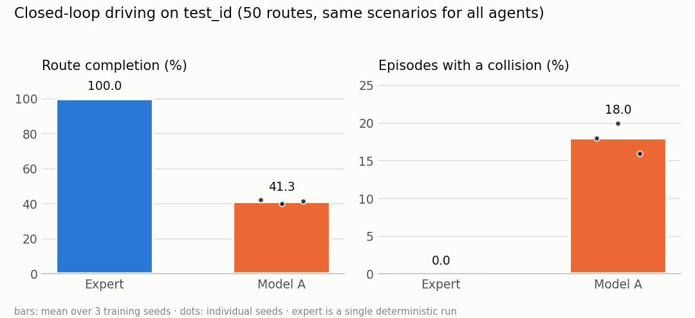

# Results Log

Each section reports one completed experiment. Numbers are copied from committed summaries in
`docs/results/` (generated from run directories, never typed by hand), and every number is
labelled with the split it comes from.

## Phase 4 — Model A (single-frame CNN behaviour cloning)

Summary file: [`docs/results/phase4_model_a.json`](results/phase4_model_a.json).

### Setup

| Item | Value |
|---|---|
| Model | Compact CNN encoder (1.07 M) + speed/command MLP + waypoint MLP head; 1.15 M parameters in total |
| Inputs | Current 96×160 RGB image, ego speed, navigation command (no privileged state) |
| Output | 10 waypoints at 0.2 s spacing (2 s) in the ego frame |
| Data | `expert_v1` train (75,488 samples) |
| Loss / optimiser | L1 on waypoints; AdamW 3e-4, weight decay 1e-4, cosine schedule, 12 epochs, batch 64, ±10% brightness/contrast jitter |
| Sampling | Frames that stay stationary for the whole 2 s window are weighted 0.3 (22.5% of samples) |
| Selection | Best validation ADE (val split only) |
| Seeds | 3 training seeds (0, 1, 2) |
| Closed loop | Predicted waypoints → target speed \|w₂ − w₀\| / 0.4 s → the expert's pure-pursuit + PID controller |
| Test set | `test_id`: maps 3000–3009, 5 routes each (50 scenarios), routes/traffic not seen in the dataset, identical for all agents |

### Training cost (GTX 1650 Ti, FP32)

| Measure | Value |
|---|---|
| Time per seed | 761–796 s (12 epochs, ~1,200–1,290 samples/s, data-loading bound) |
| Peak GPU memory | 744 MiB allocated / 1,350 MiB reserved (includes batch-256 validation) |
| Training process RSS | 1.5–1.7 GiB |
| Inference, batch 1 | GPU 3.4 ms p50; CPU (1 thread, 4 parallel evaluation workers) 8.6–9.3 ms p50, 12.6–14.0 ms p95 |

### Open loop (`test_id`, 17,137 samples; mean ± sd over 3 seeds)

| Predictor | ADE (m) | FDE (m) |
|---|---|---|
| Stand still | 4.399 | 8.026 |
| Constant velocity, straight | 0.768 | 1.963 |
| **Model A** | **0.162 ± 0.002** | **0.409 ± 0.006** |

By command (ADE, m): LANE_FOLLOW 0.192, LEFT 0.169, RIGHT 0.109, STRAIGHT 0.125. Moving
frames: 0.199. Stationary frames: 0.040.
Validation ADE at the selected epoch: 0.157 / 0.161 / 0.161.

### Closed loop (`test_id`, 50 scenarios)

| Metric | Expert | Model A (mean ± sd, 3 seeds) |
|---|---|---|
| Route completion | 1.000 | 0.413 ± 0.011 |
| Success rate (route completed) | 1.00 | 0.087 ± 0.023 |
| Episodes with a collision | 0.00 | 0.180 ± 0.020 |
| Driving score (secondary) | 1.000 | 0.323 ± 0.014 |
| Collisions / km | 0 | 1.39 ± 0.18 |
| Red-light violations / km | 0 | 4.05 ± 0.13 |
| Off-road / km | 0 | 2.41 ± 0.12 |
| Lane departures / km | 0 | 8.78 ± 0.79 |
| Route deviations / km | 0 | 3.28 ± 0.12 |

Paired difference in route completion, model A − expert (per-seed bootstrap 95% CI over the 50
scenarios): −0.578 [−0.649, −0.502], −0.599 [−0.662, −0.532], −0.584 [−0.658, −0.504].

Terminal outcomes pooled over the 3 seeds (150 episodes): 13 route complete, 63 route
deviation, 47 off-road, 27 collisions (22 with vehicles, 5 with pedestrians).

### Diagnosis

1. **The learned policy fails, not the pipeline.** An oracle feeds privileged route waypoints
   through the *same* target-speed rule and controller. On the 30 val scenarios it completes
   30/30 with |lateral error| ≤ 0.44 m.
2. **Failures concentrate at junctions.** 76% of failure-terminated episodes (104/137) end on a
   junction connector: LEFT 40, STRAIGHT 37, RIGHT 21, LANE_FOLLOW 6. Rendered rollouts show
   the cause: inside the large, unmarked junction discs the camera sees nearly uniform
   asphalt. The policy predicts a curved path even under STRAIGHT and drifts out of the route.
   Once off the expert's line, nothing in the input pulls it back. This is the compounding-error
   failure of behaviour cloning, amplified by a stylised junction design in the simulator.
3. **Signals are rarely obeyed** (about 4 red-light violations per km). Signal heads are about 3×5 px at
   160×96 (a limitation flagged in Phase 2), and a single frame gives no cue about the phase.
4. **Open-loop error does not predict closed-loop performance.** ADE is 4.7× better than
   constant velocity, yet only 8.7% of routes are completed. Seeds agree closely, so this is
   systematic, not seed noise.

### Assessment against the Phase 4 acceptance criterion

"The learned model can complete basic driving routes in closed loop, and its performance is
measured against a baseline." **Partially met.** The model completes some routes (13/150) and
41% of route distance on average, and is measured against the expert on paired scenarios. But
it is not a competent driver. Under the protocol this is reported as-is.

### Implications for later phases

- For RQ2 (temporal model), model A is a weak but well-measured baseline. A temporal model
  could plausibly help with signal phase and with recovery inside junctions.
- For introspection (Phase 6), model A fails often (about 1.4 collisions/km plus frequent route
  deviations). That gives many failure events, but a policy this weak makes "predicting
  failure" partly trivial (e.g. "at a junction → risky"). The heuristic baselines in the
  protocol (§6) must include such context cues.
- Options that change the *benchmark* or the *training method* (junction markings, DAgger,
  route target points) are listed in the README's open decisions and require sign-off before
  use. None has been applied.
